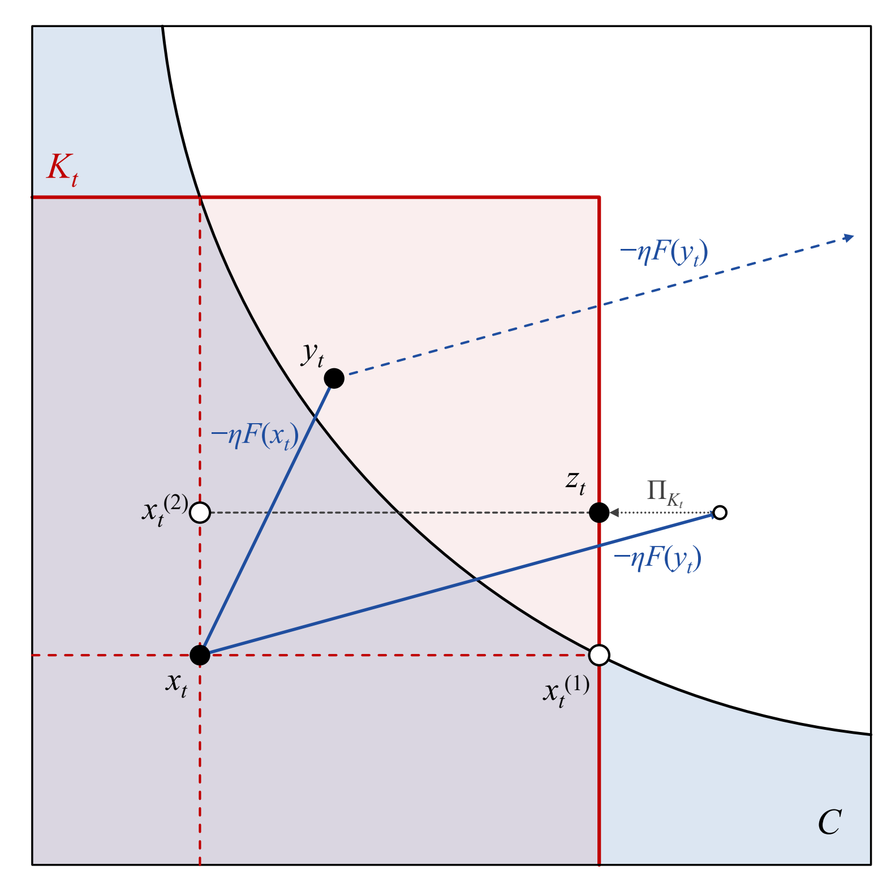
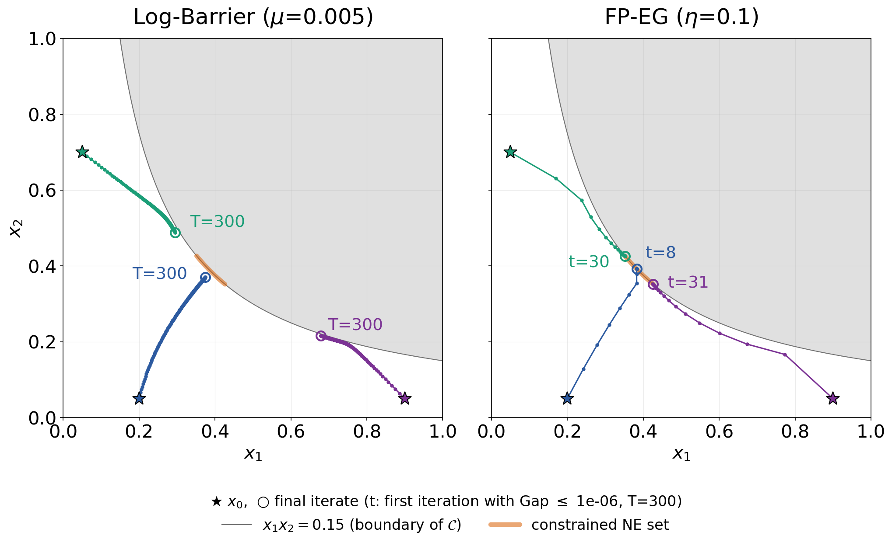
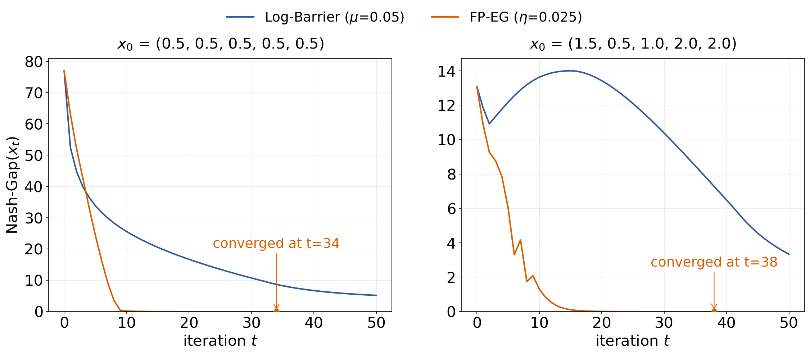
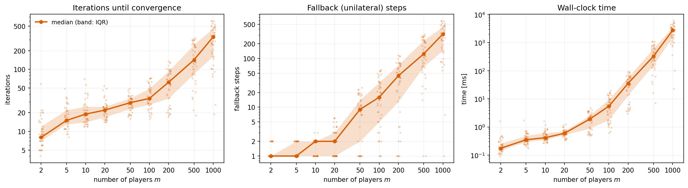
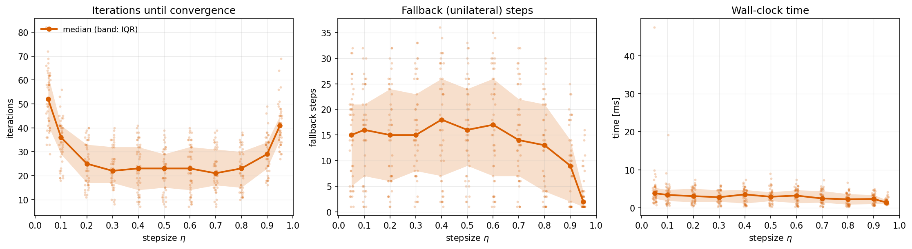

# Beyond Joint Convexity: Existence and Feasibility-Preserving Computation of Constrained Nash Equilibria

Code for the numerical experiments in the paper, on **FP-EG** (Feasibility-Preserving ExtraGradient,
Algorithm 1). FP-EG finds Nash equilibria of potential games whose players share a
coupling constraint, and every iterate stays feasible.

## FP-EG in one picture

<p align="center">
  
</p>

One iteration from a feasible point `x_t` (vector version: [`algorithm.pdf`](algorithm.pdf)):

1. **Moving set.** `K_t = C_1(x_{t,-1}) x ... x C_m(x_{t,-m})` (red box) is the product of each
   player's feasible-response set given the others' current strategies. It is convex even when
   the joint feasible set `C` (blue) is not.
2. **Predictor / corrector.** `y_t = Π_{K_t}(x_t - η F(x_t))` and `z_t = Π_{K_t}(x_t - η F(y_t))`,
   where `F` is the game mapping (the gradient of the cost potential `Ψ`). Both points lie in
   `K_t`, but not necessarily in `C`.
3. **Accept or fall back.** If `z_t ∈ C`, then `x_{t+1} = z_t`. Otherwise every unilateral
   candidate `x_t^(i) = (z_{t,i}, x_{t,-i})` is feasible, and FP-EG moves to the candidate with
   the smallest potential.

In all games below, every `C_i(x_{-i})` is an interval, so the projection onto `K_t` is a
coordinatewise clip and the Nash gap can be computed exactly.

## Repository structure

```
.
├── algorithm.pdf / .png    # illustration of one FP-EG iteration (above)
├── Cooperative/            # 2-player identical-interest game, non-convex constraint x1*x2 <= 1-alpha
│   ├── coop_game.py                  # game, FP-EG, log-barrier gradient ascent
│   ├── coop_game_trajectory.py       # trajectory plot: log-barrier vs. FP-EG
│   └── results_trajectory/
├── Routing/                # 5-player network routing game with link capacities
│   ├── routing_game.py               # game, FP-EG, log-barrier gradient ascent
│   ├── routing_nash_gap.py           # Nash gap vs. iteration: log-barrier vs. FP-EG
│   └── results_nash_gap/
└── Shared_Resource/        # m-player game with a non-convex (star-shaped) shared capacity constraint
    ├── shared_resource_game.py       # game, FP-EG
    ├── fpeg_scaling.py               # scaling of FP-EG with the number of players m
    ├── fpeg_eta.py                   # sensitivity of FP-EG to the stepsize eta
    ├── results_scaling/
    └── results_eta/
```

Each `*_game.py` file is self-contained. Its module docstring defines the game (utilities,
constraints, potential, Lipschitz constant `L`, feasible-response sets). The other scripts produce
the figures.

## Conventions

- **Cost form.** Player `i` minimizes `f_i = -u_i`; `Ψ` is the cost potential and `F = ∇Ψ`.
- **`tol` vs. `eps`.** `tol` (default `1e-12`) is the feasibility tolerance used by `is_feasible`
  and by FP-EG's acceptance test. `eps` is a Nash-gap threshold.
- **Convergence.** An algorithm counts as converged at the first iteration `t` with
  `Gap(x_t) <= eps` (default `eps = 1e-6` in every experiment). If this does not happen within
  the iteration budget, the run is reported at `T`.

## Experiments

### Cooperative game

The two-player cooperative game of Jordan & Kamgarpour (2026), Sec. 5:
`u_1 = u_2 = (x_1 + x_2) - a(x_1 - x_2)^2 - b(x_1^2 + x_2^2)` on `[0,1]^2` with `a = b = 1`, and
the shared constraint `x_1 x_2 <= 1 - alpha = 0.15`. The constrained equilibria form an arc of
the boundary `x_1 x_2 = 0.15`.

`coop_game_trajectory.py` plots the trajectories of log-barrier gradient ascent
(`mu = 0.005`, stepsize `0.05 * beta_t` with feasibility margin `beta_t`) and of FP-EG
(`eta = 0.1`) from three initial points, for `T = 300` iterations. Each final iterate is labelled
`t=...` (first iteration with `Gap <= eps`) or `T=300` (not reached).

<p align="center"></p>

### Routing game

The five-player network routing game of Tatarenko (2017), Ex. 2.2, as used in
Jordan & Kamgarpour (2026), Sec. 5, with capacities on links `l2` (2.7) and `l5` (7).
`routing_nash_gap.py` plots the Nash gap over `T = 50` iterations for log-barrier gradient ascent
(`mu = 0.05`, stepsize `beta_t / 100` as in the reference implementation) and FP-EG
(`eta = 0.025 < 1/L ≈ 0.027`). FP-EG's curve stops at convergence, marked `converged at t=...`.

<p align="center"></p>

> **Note.** The released code of Jordan & Kamgarpour uses `P_1'(s) = 5s + 1` for the cost
> `P_1(s) = 5s^2 + s`. `routing_game.py` uses the correct derivative `10s + 1`, so the log-barrier
> curves do not reproduce their Figure 6 exactly.

### Shared-resource game

The pairwise-overhead shared-resource game (Sec. 3.4 / App. C.1) with `m` players:

- strategies `x_i ∈ [0, 1]`, utilities `u_i(x) = -(x_i - v_i)^2 / 2`;
- one capacity constraint `g(x) = 1'x + x'Qx / 2 <= B` with `Q = (11' - I)/m` and `B = m/2`;
- `v ~ Uniform(0,1)^m`, redrawn until `g(v) > B`, so the constraint binds at the equilibrium.

`Q` is indefinite, so the feasible set is not convex (it is star-shaped w.r.t. 0). Each setting is
run on 45 random instances (`seed = 0, ..., 44`) from `x_0 = 0`; the figures show the median, the
IQR band and every run.

- `fpeg_scaling.py`: iterations until convergence, fallback steps and wall-clock time of FP-EG
  (`eta = 0.9 < 1/L = 1`) for `m = 2, ..., 1000` (log-log axes).

  <p align="center"></p>

- `fpeg_eta.py`: the same quantities versus the stepsize `eta = 0.05, ..., 0.95` for `m = 50`.
  It also saves the iterations panel alone as `fpeg_eta_iterations.png`.

  <p align="center"></p>

Wall-clock time counts only the FP-EG steps; the Nash-gap checks used to detect convergence
are not timed.

## Requirements

- Python 3.9+ (tested with Python 3.13)
- NumPy, Matplotlib

```bash
pip install -r requirements.txt
```

## Reproducing the figures

Run each script from inside its folder, because the scripts import the game module next to them:

```bash
cd Cooperative     && python coop_game_trajectory.py && cd ..
cd Routing         && python routing_nash_gap.py     && cd ..
cd Shared_Resource && python fpeg_scaling.py && python fpeg_eta.py && cd ..
```

With the default arguments, these commands reproduce the figures in the `results_*` folders.
Each figure is saved as PNG and as PDF (vector, for the paper). Every script accepts command-line
options, listed by `--help`. For example:

```bash
python coop_game_trajectory.py --mu 0.001 --eta 0.1 --T 500 --x0s 0.2 0.05 0.05 0.7
python routing_nash_gap.py --eps 1e-10 --T 60
python fpeg_scaling.py --ms 2 5 10 20 50 100 --seeds 20 --eta 0.9
python fpeg_eta.py --m 100 --etas 0.1 0.3 0.5 0.7 0.9 --out results_eta_m100
```

The shared-resource instances are seeded, so iteration and fallback counts are deterministic;
wall-clock times depend on the machine and vary between runs. With the defaults,
`fpeg_scaling.py` takes a few minutes (most of it at `m = 500, 1000`); the other scripts take
seconds.

## Using the code

```python
from shared_resource_game import SharedResourceGame, run_fp_eg

game = SharedResourceGame(m=20, seed=0)
xs = run_fp_eg(game, eta=0.9, eps=1e-6)      # iterates x_0, ..., x_t (all feasible)
print(len(xs) - 1, "iterations, Nash gap:", game.gap(xs[-1]))
```

## References

- P. Jordan and M. Kamgarpour (2026). *Nash Equilibria in Games with Playerwise Concave Coupling Constraints: Existence and Computation*. ICML 2026.
- T. Tatarenko (2017). *Independent log-linear learning in potential games with continuous actions*. IEEE Transactions on Control of Network Systems.
